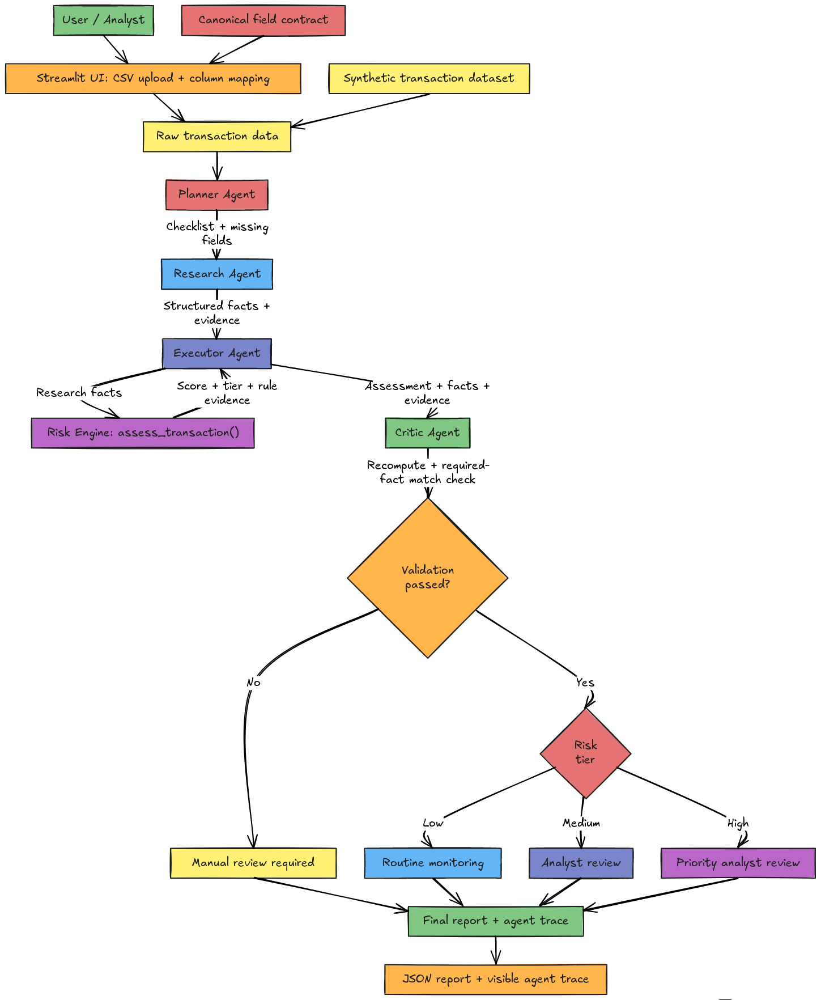
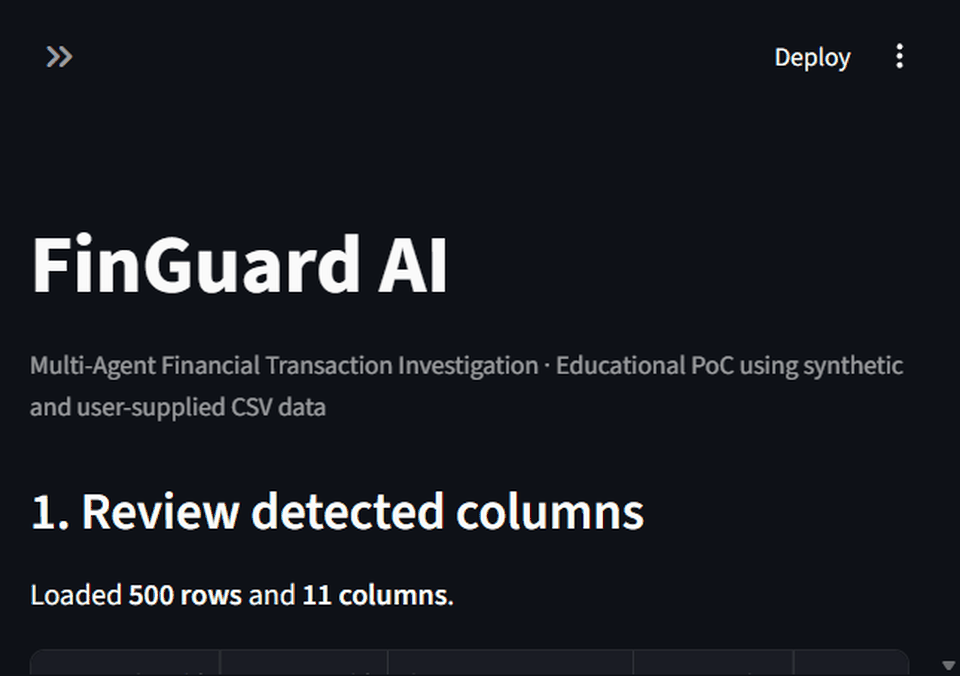

# FinGuard AI — Multi-Agent Transaction Review PoC

An educational Python and Streamlit prototype that coordinates four deterministic agents to review synthetic transaction risk indicators and recommend a human review priority. It is **not** a fraud detector and does not decide whether a transaction is “real” or “fake.”

<p align="center">
  
</p>

<p align="center"><em>Architecture preview · see <a href="ARCHITECTURE.md">ARCHITECTURE.md</a> for the full workflow.</em></p>

## Results at a glance

Evaluated with the current rules on all **500 rows** in `data/transactions.csv`:

| Review outcome | Transactions | Share |
|---|---:|---:|
| Routine monitoring | 448 | 89.6% |
| Analyst review | 48 | 9.6% |
| Priority analyst review | 4 | 0.8% |
| **Total** | **500** | **100%** |

- Mean illustrative risk score: **11.15/100**
- Critic consistency/evidence validation: **500/500 passed**
- Unit tests: **17 passed**
- **Classification accuracy: not measured.** The synthetic CSV has no verified fraud/legitimate ground-truth labels. A 500/500 Critic pass rate measures consistency with the implemented rules—not fraud prediction accuracy.
- **Performance benchmark: not measured.** No latency, throughput, or comparison benchmark is claimed.

More detail and limitations: [`RESULTS.md`](RESULTS.md).

## Agent workflow

1. **Planner** checks the required fields and sends Research a structured checklist.
2. **Research** passes supplied transaction facts and evidence to Executor; it does not invent missing values.
3. **Executor** scores the Research handoff using the single source of scoring rules in `risk_engine.py`.
4. **Critic** checks the assessment and verifies the evidence handoff against the input.
5. **Orchestrator** maps a validated score to routine monitoring, analyst review, or priority analyst review. Failed validation goes to manual review.

Agents communicate through structured Python data and function calls. They are deterministic mock-model agents, not separate LLMs. Critic recomputation uses the same risk-engine function as Executor, so it can catch tampered output or mismatched evidence but not a scoring bug shared by that function.

## Run locally

From the project folder in PowerShell:

```powershell
python -m venv .venv
.\.venv\Scripts\Activate.ps1
pip install -r requirements.txt
streamlit run app.py
```

Open the local URL printed by Streamlit (usually `http://localhost:8501`). The dashboard loads `data/transactions.csv` by default. Choose a transaction and select **Run investigation** to see the agent trace, risk evidence, decision, and validation result.

Run the test suite:

```powershell
python -m unittest discover -s tests -v
```

## Risk rules

| Indicator | Points |
|---|---:|
| Amount greater than INR 50,000 | 25 |
| New location flag | 20 |
| At least 4 transactions in 10 minutes | 25 |
| New beneficiary flag | 15 |
| Outside usual hours flag | 15 |

Scores are capped at 100: Low (0–29), Medium (30–59), High (60–100). These illustrative weights are not calibrated probabilities or empirically validated fraud thresholds.

## Demo media

The animation below uses captures of the running Streamlit dashboard: loaded synthetic dataset → selected transaction `TXN00003` → validated priority-review result.

<p align="center">
  
</p>

The repository also includes the static architecture image above and a PowerPoint walkthrough: [`FinGuard_AI_CA3_Presentation.pptx`](FinGuard_AI_CA3_Presentation.pptx). Individual captures are available in [`media/`](media/).

## Repository map

- `app.py` — Streamlit dashboard, CSV mapping, investigation results, and JSON export
- `orchestrator.py` — sequential agent handoffs and final decision
- `agents/` — Planner, Research, Executor, and Critic components
- `risk_engine.py` — validation, deterministic rules, risk tiers, and assessment output
- `data/transactions.csv` — 500 synthetic transactions
- `tests/` — unit tests for risk logic, agents, and CSV mapping
- `ARCHITECTURE.md` — Mermaid architecture diagram and data flow
- `RESULTS.md` — measured synthetic-data results and evaluation limitations

> **Safety note:** Coursework demonstration only. Use synthetic data. Scores support human review and must not be used to automatically block accounts or make real financial decisions.
